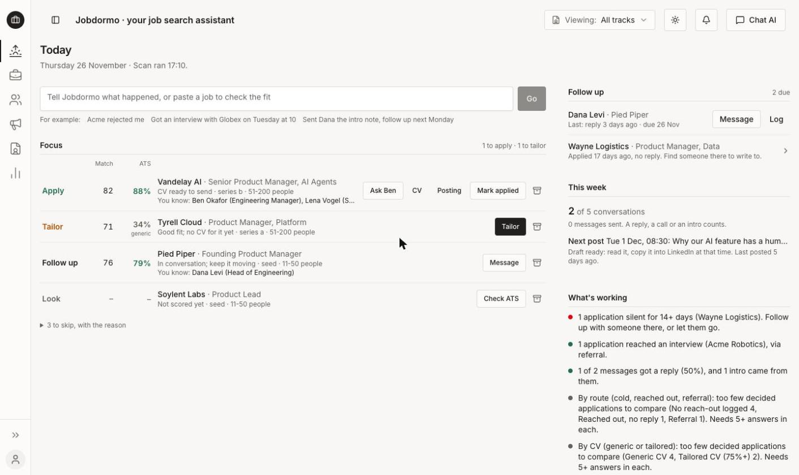
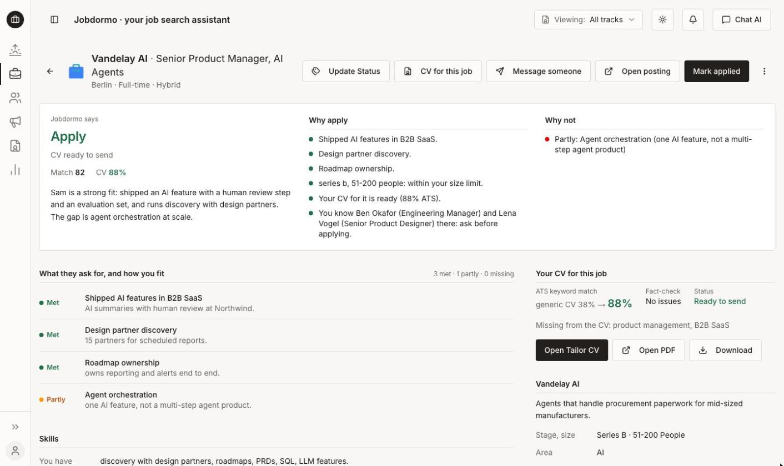
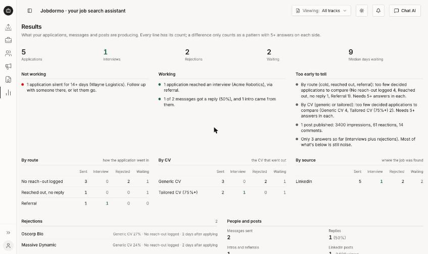
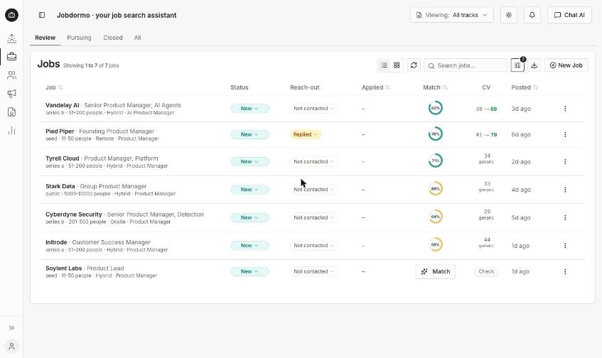
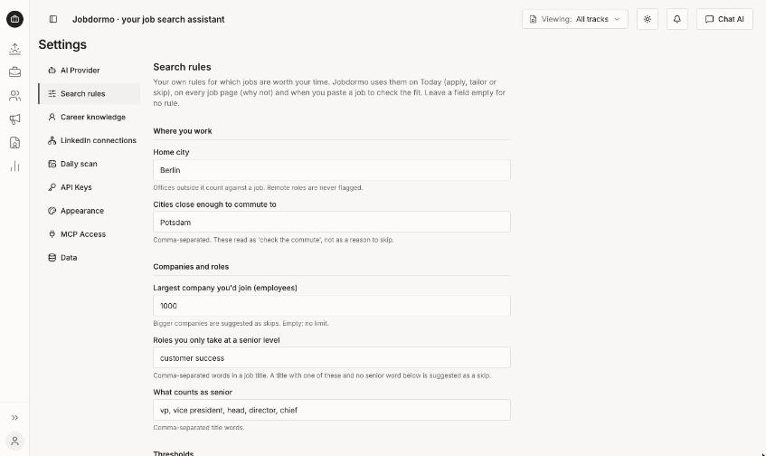
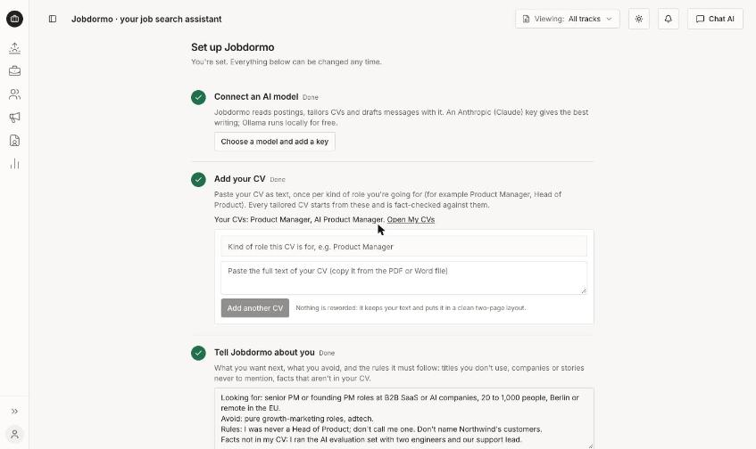

# Jobdormo

A self-hosted job-search assistant. It does the slow parts of a job search overnight and hands you a short morning list: which jobs are worth your time, which CV is ready to send, who you know there, and who to follow up with. When something happens, you tell it in one line ("Acme rejected me", "got an interview with Globex on Tuesday") and it keeps the record.

It's honest by design: every CV it tailors is checked against your own history before it goes out, and every number says what it measures.



## What it does

- **Today.** One list in the order you think: apply to these, tailor these, follow up with these people, skip these (and why). Match and ATS score side by side, with one-click actions on every row.
- **Tell it what happened.** Type "Acme rejected me" or "sent Dana the intro note, follow up Monday" and it proposes the changes; nothing is saved until you press Apply.
- **Paste a job, see if it fits.** Paste any posting (LinkedIn page and all) to get Apply, Long shot or Skip, each requirement marked met, partly or missing against your CV, who you know there, and your own rules applied (office location, company size, seniority).
- **Tailored CVs that pass ATS without lying.** It uses the posting's keywords wherever they're true for you, asks about the ones it can't place and remembers your answers, then fact-checks every line against your CVs and notes. A CV is ready to send at your ATS target (75% by default).
- **One page per job.** The verdict, why apply, why not, each requirement against your CV, your CV for it, the people you know there, the company, notes and the posting.
- **People and LinkedIn connections.** Import your LinkedIn export; every job shows who you know at the company, and messages are drafted in your voice.
- **LinkedIn posts.** The next post is always drafted for its slot (Tuesday or Thursday morning), rotating themes and learning from your results. Nothing is ever posted for you.
- **Results.** What's working and what isn't, from your own applications: which route got answers, generic versus tailored CVs, how fast rejections came. It won't call something a pattern until there are enough answers.
- **A morning scan.** Job boards and company career pages (Greenhouse, Lever, Ashby, Workable, Comeet, VC portfolio boards and more), deduplicated, scored against the right CV, with CVs tailored for the best fits.

| Job page | Results |
|---|---|
|  |  |
| **Jobs** | **Search rules** |
|  |  |

## Getting started

You need Node 22.19 or newer (24 recommended), Docker for Postgres, Chrome or Chromium for CV PDFs, and an AI model: an [Anthropic](https://console.anthropic.com) API key gives the best results; [Ollama](https://ollama.com) runs locally for free.

```bash
git clone https://github.com/alajter/jobdormo.git
cd jobdormo
npm install
cp .env.example .env          # set POSTGRES_PASSWORD, AUTH_SECRET, ENCRYPTION_KEY
docker compose -f docker-compose.local.yml up -d
# in .env: DATABASE_URL=postgresql://jobdormo:<POSTGRES_PASSWORD>@127.0.0.1:5440/jobdormo
npx prisma migrate deploy
npm run dev                   # http://localhost:3737
```

Create an account, and Jobdormo walks you through setup: connect a model, paste your CV (once per kind of role you're going for), a few lines about you, then your search rules and LinkedIn connections. Your CVs live in a folder on your machine (`CV_DIR`, default `personal/cv`), as HTML you can edit and PDFs you can send.



### Try the demo first

A fictional candidate with CVs, jobs, people, posts and results, in its own database:

```bash
# in .env: DATABASE_URL pointing at an empty database, CV_DIR=demo/cv,
# JOBSYNC_USER_EMAIL=demo@jobdormo.test and a DEMO_PASSWORD of your choice
npx prisma migrate deploy
npx tsx --tsconfig scripts/tsconfig.jobs.json --env-file=.env scripts/demo-seed.ts
npm run dev                   # sign in with that email and password
```

### The morning scan

`scripts/daily-job-hunt.sh` runs the job-board automations, adds new finds, scores them, checks their ATS match, tailors CVs for the best fits and drafts the next LinkedIn post. On macOS, turn it on and pick the time in Settings → Daily scan. Elsewhere, run it from cron:

```
30 5 * * * cd /path/to/jobdormo && ./scripts/daily-job-hunt.sh
```

An optional web-search step uses the [Claude Code](https://docs.claude.com/en/docs/claude-code) CLI with a brief you write (`SEARCH_BRIEF_FILE`); without them it's skipped.

## Your data

Everything runs on your machine: the database, your CVs and notes. The only things that leave it are the AI calls to the provider you choose (or none, with Ollama), and the job boards the scan reads. API keys you add in the app are stored encrypted.

## Development

```bash
npm test                      # unit and component tests (Node 22.19+)
npx tsc --noEmit && npm run lint
```

CI runs type checks, lint, tests and a production build on every push and pull request. The product design is in [design/JOBDORMO_DESIGN.md](design/JOBDORMO_DESIGN.md).

## Credits

Jobdormo is built on [JobSync](https://github.com/Gsync/jobsync) by gsync, an open-source job-application tracker (MIT). The original README is kept in [design/JOBSYNC_README.md](design/JOBSYNC_README.md).

## License

MIT. See [LICENSE](LICENSE).
